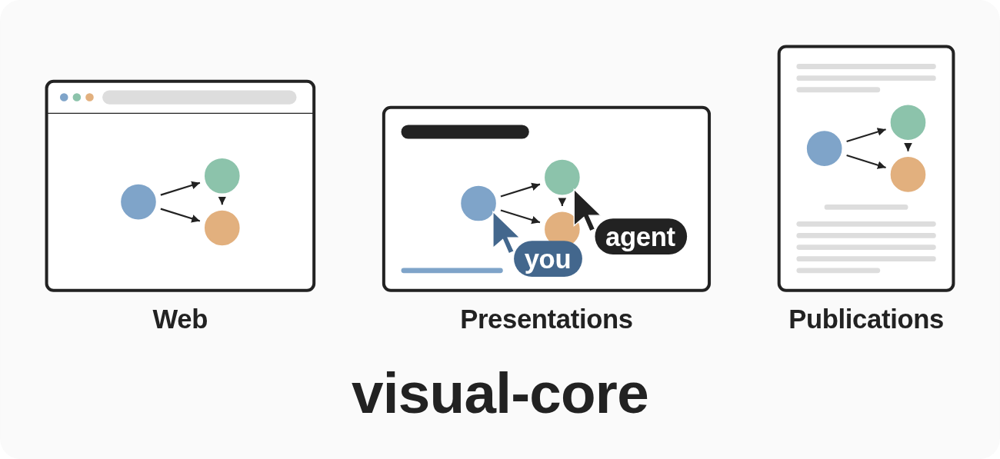
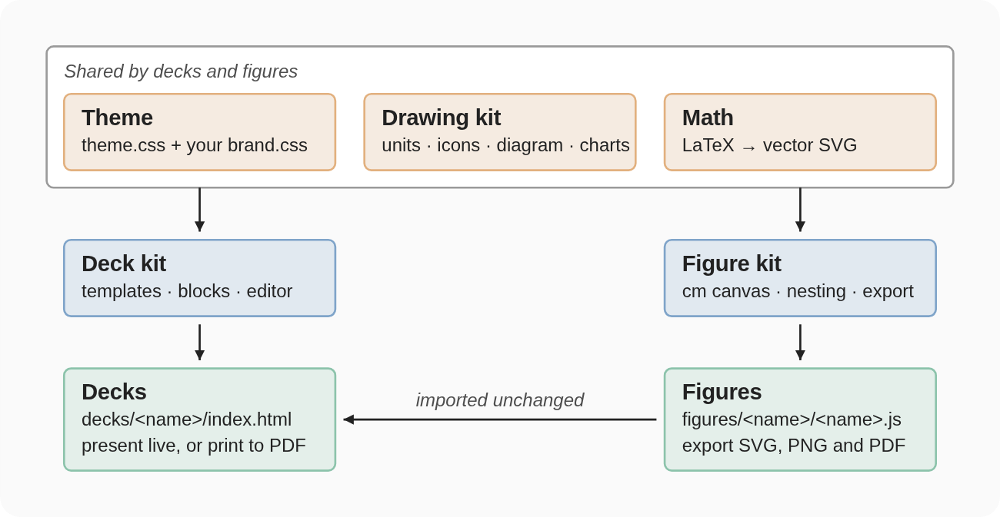
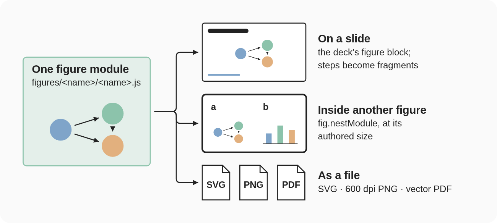
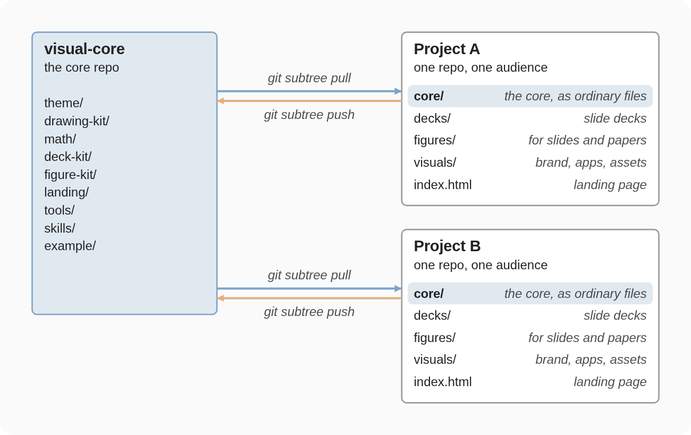

<p align="center">
  
</p>

<h2 align="center">One place to make visuals for the web, presentations and publications</h2>

<p align="center">Draw a figure once, then use it on the web, on a slide, or in a paper.</p>

<p align="center">
  <a href="https://noviaintsysgroup.github.io/visual-core/example/">Live example</a> ·
  <a href="#start-a-new-project">Get started</a> ·
  <a href="#how-it-works">How it works</a> ·
  <a href="LICENSE">License</a>
</p>

<hr>

Agents are very good at making HTML visuals, but left alone they drift from your visual style
and write code that is hard for a human to edit. This core fixes both:

- **One style.** Decks and figures share one theme, one diagram kit, and one set of slide
  templates, so agent-made visuals look like yours.
- **Editable by humans.** Each deck and figure is plain, readable HTML you can edit by hand or
  directly on the slide.
- **No build step, no framework, no npm install.** A deck runs from `file://`, a local server,
  or a static host, offline, because Reveal.js ships inside the core.
- **Draw once, reuse anywhere.** A figure drops onto a slide or into another figure unchanged,
  and exports as SVG, PDF, or 600 dpi PNG.

## See It

The core's [example project](https://noviaintsysgroup.github.io/visual-core/example/) is hosted
online and shows what a working project looks like. It includes three example decks:

- **[Hopfield networks](https://noviaintsysgroup.github.io/visual-core/example/decks/hopfield-networks/)**:
  the main example, a brief introduction to the ideas behind the 2024 Nobel Prize in Physics.
- **[Dot products](https://noviaintsysgroup.github.io/visual-core/example/decks/dot-products/)**:
  a lecture on how one operation underlies neurons, neural networks, and search in embedding space.
- **[Showcase](https://noviaintsysgroup.github.io/visual-core/example/decks/showcase/)**:
  a reference for what the slides can show, with one slide per template, block, and widget.

Each figure the decks import also has its own page, listed on the example's landing page.

## How It Works

Decks and figures share three pieces: the **theme**, the **drawing kit** (units, icons, a
TikZ-style diagram kit, a chart kit), and **math** (LaTeX to vector SVG). On top of them, the
**deck kit** builds decks and the **figure kit** builds figures. A figure knows nothing about decks,
so a deck imports it unchanged.

<p align="center">
  
</p>

A deck's `index.html` is a `SLIDES` array plus one call:

```js
Deck.mount({
  slides: SLIDES,
  storageKey: 'my-deck',
  logo: '../../visuals/assets/logo.svg',
  logoHeight: 30,   // optional; points, default 32. Sizes the mark by height.
  templates: window.Templates,
});
```

`mount()` snapshots the pristine page, renders `SLIDES` through the templates, starts Reveal, and
wires the editor. A figure is a composition module plus a thin shell calling
`Figure.mountModule(window.<Name>Figure)`.

### Figures Are The One Reusable Drawing

A drawing that a deck or another figure reuses is a **figure module**,
`figures/<name>/<name>.js`, drawn on a cm canvas. One module has three uses:

- **On a slide**, through the deck's `figure` block. A stepped figure's steps become the slide's
  fragments.
- **Inside another figure**, through `fig.nestModule`, at its authored size.
- **As a file**: SVG, 600 dpi PNG, or vector PDF, exported from the figure's own page.

A placed figure owns only the drawing; titles, captions, and prose belong to whatever places it.

<p align="center">
  
</p>

## Repository Layout

The core is not used on its own. It sits in a project repo at `core/`, and the project keeps its
own work beside it, sorted by kind rather than by deck, so a figure or a logo can serve any deck.

| To add… | Put it in | What goes there |
|---|---|---|
| A deck | `decks/<name>/index.html` | The `SLIDES` array and one `Deck.mount(...)` call; nothing else |
| A figure | `figures/<name>/` | `<name>.js` the drawing, `<name>.css` its look, `index.html` a thin shell |
| Your colours and fonts | `visuals/brand.css` | Overrides of the core's semantic tokens, loaded right after `core/theme/theme.css` |
| Logos, photos, illustrations | `visuals/assets/` | Any media a deck or figure shows |
| An interactive piece | `visuals/apps/<name>.js` | A live app, placed on a slide by the `app` block |
| Illustration prompts | `visuals/image-prompt.md` | The fixed parts of every image-generation prompt |
| The project's front page | `index.html` | A card for each deck and figure |

`core/` is shared tooling: change it only as a core change ([below](#change-the-core-from-a-project)).
`.claude/` holds the agent guardrails, copied from `core/` when the project starts.

## Start A New Project

You need git, [Bun](https://bun.sh) for the dev server, and an agent such as Claude Code.
**On Windows, run Claude Code inside WSL2.** The guardrails require its sandbox, which does not run
on native Windows, so Claude Code exits at startup there.

```bash
git init my-project
cd my-project
git commit --allow-empty -m "start project"
git subtree add --prefix=core https://github.com/NoviaIntSysGroup/visual-core.git main --squash
mkdir .claude
cp core/.claude/settings.json .claude/
cp core/example/.claude/launch.json .claude/
```

`--prefix=core` puts this repo's root (`theme/`, `deck-kit/`, ...) inside the project's `core/`.
The empty commit gives `subtree add` something to build on. The last three lines install the agent
guardrails before any agent runs; Claude Code reads settings only from the folder it starts in, so
`core/.claude/` has no effect on its own.

Then tell your agent: *Set up this project using `core/skills/new-project/SKILL.md`.* A new repo has no
`AGENTS.md` yet, so the agent finds that file only because you name it. It creates the landing page,
`AGENTS.md`, and the rest of the structure; you can also follow it by hand.

## Working With Your Agent

Ask your agent for what you want: a deck, a slide, a figure, an illustration. Before it starts, it
reads the skill for that kind of work, and the skill has it build from the core's shared pieces,
so the result follows your style. The skills also keep the files easy for a person to follow: a
deck is one `SLIDES` array, a figure one module laid out in the same order as every other, so you
can still read the logic and edit a file by hand.

Anything new that other decks could use, such as a slide template, block, icon, or colour, the
agent proposes and agrees with you before building it.

You never need to read the skills, but they are where the detail lives:

| Skill | For |
|---|---|
| [`slide-decks`](skills/slide-decks/SKILL.md) | Writing slides and building decks: layouts, tags, colour tokens |
| [`diagrams`](skills/diagrams/SKILL.md) | Constructing diagrams and charts on the shared kits |
| [`figures`](skills/figures/SKILL.md) | Composing publication figures and exporting them |
| [`illustrations`](skills/illustrations/SKILL.md) | Writing prompts for generated illustrations |
| [`new-project`](skills/new-project/SKILL.md) | Setting up a project, or moving a deck between projects |
| [`issue-log`](skills/issue-log/SKILL.md) | Logging instruction and code problems an agent hit, to `issues/` |
| [`issue-fix`](skills/issue-fix/SKILL.md) | Fixing logged problems at their cause; docs by rewriting, not appending |
| [`page-check`](skills/page-check/SKILL.md) | Screenshotting pages and exporting figures headlessly, when asked |

[AGENTS.md](AGENTS.md) holds the rules every agent session follows, and the file-by-file map.

## Editing, Presenting, And Exporting A Deck

Text can be edited on the slides; everything else is edited in the deck's `index.html`. Both work
best with the dev server running from the project root:

```bash
bun run core/tools/serve.js
```

It serves that folder on `http://localhost:8099` (or `$PORT`) with live reload: `/` is the landing
page, `/decks/<name>/` a deck, `/figures/<name>/` a figure, `/core/example/` the core's example.
Working on the core alone, run `bun run tools/serve.js` from the core folder; `/` redirects to the
example.

### On The Slides

1. Open the deck through the dev server. Opened as a file, **Edit** is disabled.
2. Click **Edit**, click any text that has an outline, and type. A formula shows its `$…$`
   source while you edit it.
3. Click **Done** to write the edits into the deck's `index.html`. Until then they are kept as a
   draft in this browser.

### In A Text Editor

Adding, removing, or reordering slides, columns, chips, and blocks, and changing a block's
options, is done in the `SLIDES` array between the `SLIDES:START` and `SLIDES:END` markers. The
page reloads on save. Keep the block strict JSON, as `JSON.stringify(slides, null, 2)` writes it:
double quotes and no comments, because **Done** rewrites everything between the markers.

> **Gotcha:** on-slide edits not yet saved with **Done** are kept only as a draft in this browser.
> Editing `SLIDES` in the file discards that draft the next time the deck opens, so finish the
> on-slide edit with **Done** first.

### Presenting

Present with the toolbar's **Fullscreen** button, or the F key. Fragments animate only in
fullscreen. In a normal tab every fragment is visible, so content can be read and edited; entering
fullscreen restarts the current slide's fragments.

### Exporting To PDF

The toolbar's **Export PDF** opens the deck in print layout and starts the browser's print
dialog; choose *Save as PDF*.

## Keeping A Project In Sync With The Core

The core is added to each project as a git subtree and committed as ordinary files, so a clone or
ZIP of a project runs with no further step. Each project keeps its own copy; a core change reaches
it only when it pulls. Git controls access per repo, so one repo is one audience, and
collaborators need no access to the core repo.

<p align="center">
  
</p>

### Update The Core In A Project

```bash
git subtree pull --prefix=core https://github.com/NoviaIntSysGroup/visual-core.git main --squash -m "update core"
```

An update can change every deck and figure. Look through the landing page, and undo the merge if
something broke.

An update does not touch the project's copied guardrails. Compare them, and copy over any change:

```bash
git diff --no-index core/.claude/settings.json .claude/settings.json
git diff --no-index core/example/.claude/launch.json .claude/launch.json
```

### Change The Core From A Project

A change to the core's kits, theme, tools, or skills can reach every project, so agree on it first;
`example/` can change freely. The simplest way is to change a clone of
the core repo and pull it, as above. To send back a change made in a project's `core/`, keep it in
commits that touch nothing else and push them to a branch:

```bash
git subtree push --prefix=core https://github.com/NoviaIntSysGroup/visual-core.git <branch-name>
```

Merge that branch in the core repo, then pull. Pushing needs write access; without it, send the
change to whoever has it.
